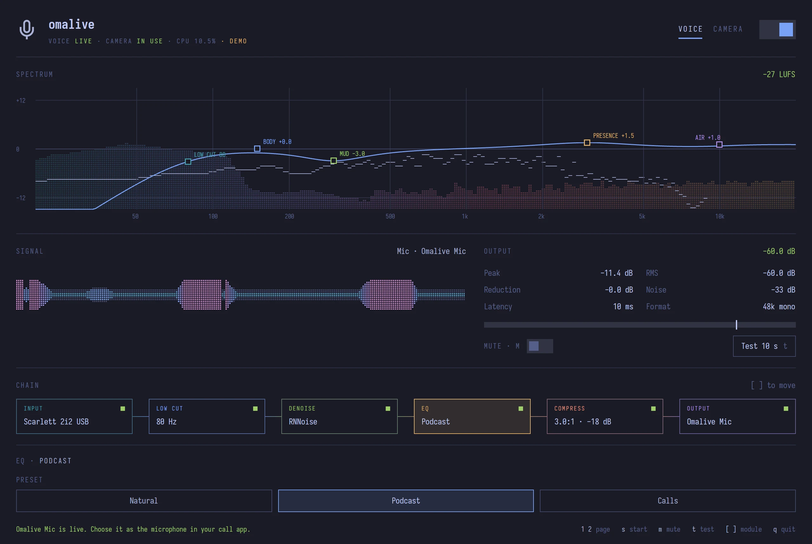
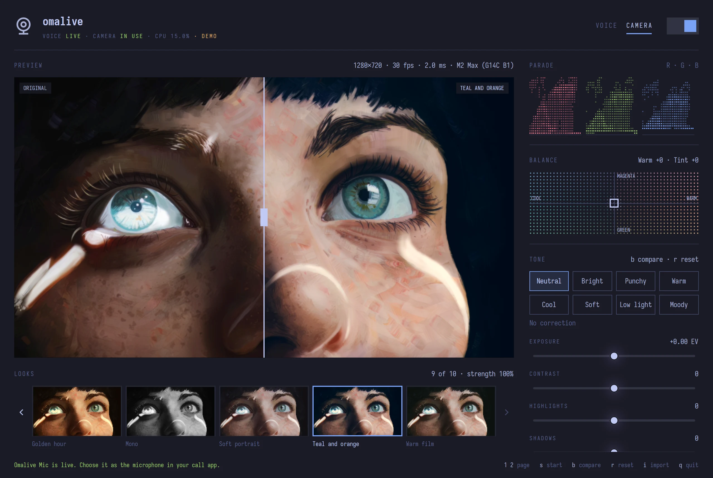
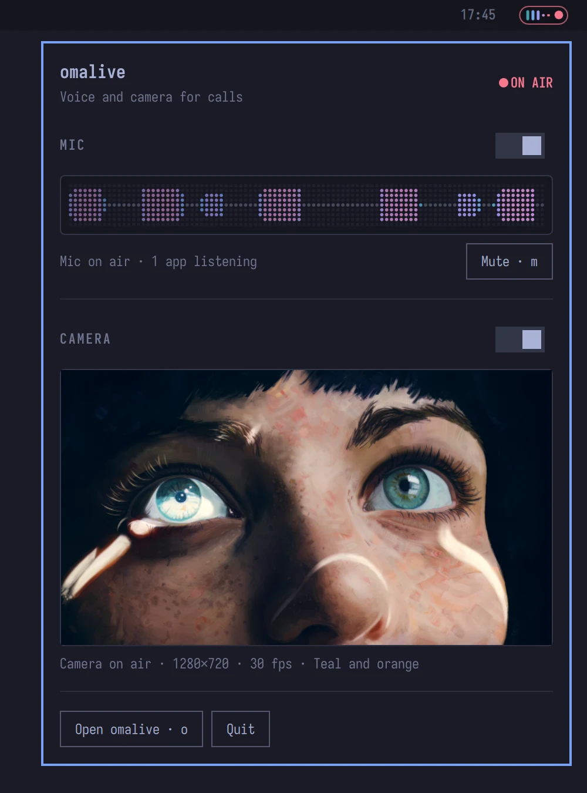

# omalive

Voice and camera processing for calls on Omarchy. omalive cleans up your
microphone, grades your camera, and shows both in the Omarchy bar. It is a
Rust app built with GPUI Kit and `gpui-omarchy`, plus a bar plugin.



- **Voice:** your microphone goes through a high-pass filter, RNNoise noise
  suppression, a four-band EQ, an SC4 compressor and a −1 dBFS limiter. It
  comes out as an **Omalive Mic** microphone you choose in any call app.
  Slider changes apply live, without dropping the microphone.
- **Camera:** your camera is colour-corrected (exposure, contrast,
  highlights, shadows, warmth, tint, vibrance, saturation) with an optional
  creative LUT. It is published as **Omalive Camera**: a PipeWire camera for
  browsers and OBS, and a V4L2 device for native apps such as Hopp, Zoom
  and Discord when v4l2loopback is loaded.
- **In the bar:** omalive keeps running when you close its window. The bar
  widget shows your mic level and whether a call is hearing or seeing you,
  with quick controls and a live picture of your camera a click away.



**Status: working development build**, tested on aarch64 Omarchy (Asahi,
M2 Max). See [validation](docs/validation.md) for what has been checked
against real hardware. The v4l2loopback output has not been tested yet.

## Requirements

- Omarchy, with its shell plugin API for the bar widget.
- Rust 1.97.0, pinned in `rust-toolchain.toml`, and these build
  dependencies:

```sh
omarchy pkg add rustup clang cmake pkgconf pipewire libjpeg-turbo libxkbcommon wayland vulkan-headers vulkan-icd-loader fontconfig
rustup toolchain install 1.97.0 --profile minimal --component rustfmt --component clippy
```

- Optional effects. omalive says which are missing and runs without them:

```sh
sudo pacman -S --needed noise-suppression-for-voice swh-plugins
```

## Install

Omarchy builds nothing, so install the app first:

```sh
git clone https://github.com/kierangraham/omalive
cd omalive
make install
```

This puts `omalive` in `~/.local/bin`, where the bar widget looks for it,
and adds a desktop entry and an icon. Then add and enable the bar widget:

```sh
omarchy plugin add https://github.com/kierangraham/omalive --enable
```

The widget goes in the right bar section unless you pick another. To
update, run `git pull && make install` in your clone, then
`omarchy plugin update kierangraham.omalive`. If the shell keeps showing
the earlier widget, run `omarchy restart shell`.

To uninstall, run `make uninstall` and
`omarchy plugin remove kierangraham.omalive`.

## Usage

Open omalive from the app launcher. Choose your microphone under **Input**,
flip the power switch in the header (or press `s`), then pick **Omalive
Mic** in your call app. On the Camera page, flip the switch and pick
**Omalive Camera**. With **Only when in use** on (the default), the camera
and its light sleep until an app opens Omalive Camera or you show the
preview.

Closing the window leaves omalive running: your mic and camera stay
processed. `Ctrl+Q` in the window, or **Quit** in the bar, ends it and
releases every device. `omalive --background` starts it without a window;
click **start at login** in the window's footer to do that at every login.
Voice and camera that were on when omalive last ran start again with it.



In the bar, omalive is one small pill:

- **Five bars** are your processed mic's last few levels; red means muted.
- **The dot** is the camera's tally light: grey while it's off or asleep,
  green while it's capturing, red while a call is watching.
- The pill's outline turns **red** while a call is hearing you.
- **Click** for quick controls: mic and camera on/off, mute, a waveform and
  a live picture of your graded camera. **Middle-click** mutes;
  **right-click** opens the window. If omalive isn't running, clicking
  starts it in the background.

The widget talks to omalive over `$XDG_RUNTIME_DIR/omalive.sock`.
Nothing in your PipeWire, Hyprland or Omarchy configuration is changed.

### Looks

**Grade presets** set every tone slider at once: Neutral, Bright, Punchy,
Warm, Cool, Soft, Low light and Moody. **LUTs** add a creative look on top,
with a strength slider. **Add looks** writes omalive's own nine, and
**Import** takes `.cube` files and Hald CLUT PNGs. For film stocks, fetch
a curated set of 20 from RawTherapee's Film Simulation collection
(CC BY-SA 4.0):

```sh
make film-looks                 # about 35 MB; fetches only the chosen looks
scripts/get-film-looks --all    # all 290-odd (about 400 MB)
```

### Test your sound

On the Voice page, press **Test 10 s** (or `t`) and talk as you would on a
call. omalive records the raw microphone and Omalive Mic side by side,
measures peak, loudness and background noise, and says what to change.
[Recommended setup](docs/setup-guide.md) has starting points for a dynamic
mic into an audio interface and a camera through a capture card.

### Native apps and v4l2loopback

Browsers and OBS use the PipeWire camera. Apps that only open
`/dev/video*` (Hopp, Zoom, Discord, Slack) need the v4l2loopback kernel
module. omalive finds a loopback device and writes to it.

```sh
sudo pacman -S v4l2loopback-dkms    # needs headers for your running kernel
echo 'options v4l2loopback devices=1 video_nr=10 card_label="Omalive Camera" exclusive_caps=1 max_buffers=2' \
  | sudo tee /etc/modprobe.d/omalive-v4l2loopback.conf
echo v4l2loopback | sudo tee /etc/modules-load.d/omalive-v4l2loopback.conf
sudo modprobe v4l2loopback
```

### Keyboard

| Keys | Action |
| --- | --- |
| `1` / `2` | Voice / Camera page |
| `s` | Start or stop the current page |
| `m` | Mute or unmute Omalive Mic |
| `t` | Record a 10 second voice test |
| `b` | Compare the graded camera with the original |
| `a` | Apply input or effect changes (restarts the chain) |
| `[` / `]` | Previous / next module in the voice chain, or look on the Camera page |
| `r` | Reset the camera grade |
| `i` / `o` | Import a LUT / open the LUT folder |
| `Ctrl+=` / `Ctrl+-` / `Ctrl+0` | Zoom |
| `q` / `Ctrl+Q` | Quit (closing the window keeps omalive running) |

Settings live in `~/.config/omalive/settings.json` and LUTs in
`~/.config/omalive/luts`.

## Demo mode

```sh
make demo
```

This runs omalive with a simulated microphone and a test-pattern camera.
It touches no devices and saves nothing. `OMALIVE_DEMO_PICTURE=image.jpg`
pans the camera across a picture instead. The screenshots above and the
[promo film](https://kierangraham.com/media/promo/omalive-web.mp4) were
recorded in demo mode.

## Development

```sh
make run         # release build of the app
make test        # unit and GPUI interaction tests; no devices needed
make shell-test  # the bar widget: model tests, then a hidden Quickshell against a demo
make lint        # rustfmt check and clippy -D warnings
make check       # cargo check of every target
make probe       # live checks against your session (first microphone and camera)
make plugin      # copy this checkout's bar widget into the shell, instead of a git clone
```

The plugin's `manifest.json` sits at the repo root, and its QML is in
`shell/`. Read [architecture](docs/architecture.md) for the crates and
threads, and [performance](docs/performance.md) for the measurements behind
the design.

## Licence

MIT. RNNoise, SC4, v4l2loopback and the Omarchy components keep their own
licences. Only public documentation and open-source components were
consulted:

- [PipeWire filter-chain](https://docs.pipewire.org/page_module_filter_chain.html)
- [RNNoise plugin](https://github.com/werman/noise-suppression-for-voice)
- [SC4 mono](https://github.com/swh/ladspa/blob/master/sc4m_1916.xml)
- [v4l2loopback](https://github.com/v4l2loopback/v4l2loopback)
- [Disktree](https://github.com/tobi/disktree)

---

[kierangraham.com](https://kierangraham.com)
