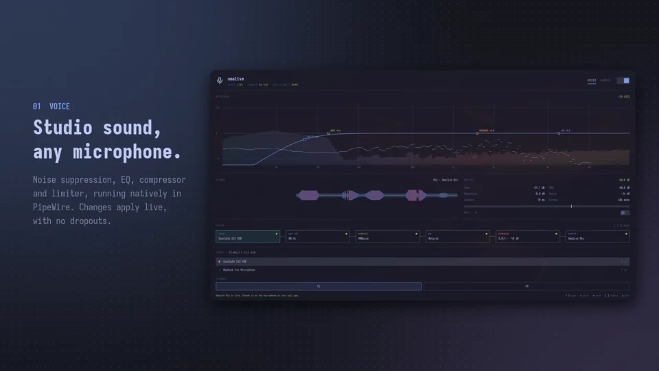
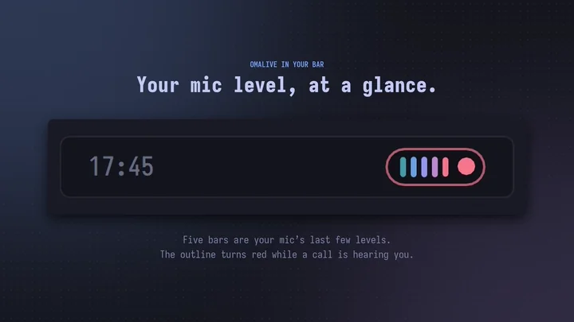

# omalive

Clean up your microphone and colour-grade your camera for video calls.
omalive is a desktop app and bar widget for [Omarchy](https://omarchy.org),
the Arch Linux and Hyprland setup.

[](https://kierangraham.com/media/promo/omalive-short.mp4)

[Watch the film (30 s, with sound)](https://kierangraham.com/media/promo/omalive-short.mp4)

omalive gives you two devices to pick in any call app:

| Device | What you get |
| --- | --- |
| **Omalive Mic** | Your microphone through a high-pass filter, RNNoise noise suppression, a four-band EQ, a compressor and a limiter |
| **Omalive Camera** | Your camera with exposure, white balance, tone and an optional LUT applied on the GPU |

It runs in the background once set up. The bar widget shows when a call
can hear or see you.

**Status: 0.1.0, an early release.** So far it has been tested on aarch64
only. [Testing](docs/testing.md) lists what has and hasn't been checked.

## Install

**Install the app first, then add the bar widget.** The widget needs the
app. Omarchy installs the widget from git and builds nothing.

### 1. Install the app

Choose one of these three ways, in order of preference.

**The Arch package** builds the `v0.1.0` release. It installs `omalive`
in `/usr/bin` with its desktop entry, icon and licence. `makepkg -s`
installs the build tools it needs.

```sh
sudo pacman -S --needed base-devel git
git clone https://github.com/kierangraham/omalive
cd omalive/packaging/arch
makepkg -si
```

The package installs the app only. Omarchy manages the bar widget's
folder itself, so step 2 adds it.

**Cargo** installs only the binary, into `~/.local/bin`. It adds no desktop
entry or icon.

```sh
sudo pacman -S --needed base-devel rustup clang cmake pkgconf libjpeg-turbo libxkbcommon libxkbcommon-x11 libpipewire wayland vulkan-icd-loader
rustup default stable
cargo install --git https://github.com/kierangraham/omalive --tag v0.1.0 --locked --root ~/.local omalive-app
```

**`make install`** builds from a clone. It installs the binary, desktop
entry and icon under `~/.local`. The repo pins Rust 1.97.0.

```sh
sudo pacman -S --needed base-devel git rustup clang cmake pkgconf libjpeg-turbo libxkbcommon libxkbcommon-x11 libpipewire wayland vulkan-icd-loader
rustup toolchain install 1.97.0 --profile minimal
git clone https://github.com/kierangraham/omalive
cd omalive
make install
```

`make install PREFIX=/usr/local` installs elsewhere. Packagers can add
`DESTDIR`.

### 2. Add the bar widget

```sh
omarchy plugin add https://github.com/kierangraham/omalive --enable
```

The widget goes in the right section of the bar unless you pick another.

### Optional effects

**RNNoise and the compressor come from two packages.** Without them,
omalive explains what is missing and runs the rest of the chain.

```sh
sudo pacman -S --needed noise-suppression-for-voice swh-plugins
```

Native apps that only open `/dev/video*`, such as Zoom, Discord and Slack,
need [v4l2loopback](#native-call-apps). Browsers and OBS don't.

## Update

| Installed with | Update by running |
| --- | --- |
| The Arch package | `git pull` in your clone, then `makepkg -si` in `packaging/arch` |
| Cargo | the same `cargo install` command with the new `--tag` and `--force` |
| `make install` | `git pull && make install` in your clone |
| The bar widget | `omarchy plugin update kierangraham.omalive` |

If the bar still shows the old widget after an update, run
`omarchy restart shell`.

## Uninstall

1. **Turn off start at login first.** The switch is in the footer of
   omalive's window. Otherwise the autostart entry stays behind.
2. Remove the bar widget:

   ```sh
   omarchy plugin remove kierangraham.omalive
   ```

3. Remove the app the way you installed it:

   | Installed with | Remove with |
   | --- | --- |
   | The Arch package | `sudo pacman -R omalive` |
   | Cargo | `cargo uninstall --root ~/.local omalive-app` |
   | `make install` | `make uninstall` in your clone, which also removes the autostart entry |

**Your settings and looks stay** in `~/.config/omalive`. Delete that folder
to remove them too.

## Usage

### Voice

1. Open **omalive** from the app launcher.
2. Choose your microphone under **Input**.
3. Flip the power switch in the header, or press `s`.
4. Pick **Omalive Mic** as the microphone in your call app.


**Slider changes apply live**, without dropping the microphone. Changing the
input or turning an effect on or off needs **Apply**, which restarts the
chain.

**Test your sound** with **Test 10 s**, or `t`. omalive records the raw
microphone and Omalive Mic side by side. It measures peak, loudness and
background noise, and says what to change. **Play processed** and **Play
original** play the takes back.
[Recommended setup](docs/setup-guide.md) has starting points for a dynamic
microphone and for a camera through a capture card.

### Camera

1. Open the **Camera** page, or press `2`.
2. Flip the power switch.
3. Pick **Omalive Camera** in your call app.


**Only when in use is on by default, so the camera sleeps.** The camera
and its light stay off until an app opens Omalive Camera or you show the
preview.

A look has two layers:

- **Grade presets** set every tone slider at once: Neutral, Bright, Punchy,
  Warm, Cool, Soft, Low light and Moody.
- **LUTs** add a creative look on top, with a strength slider. **Add looks**
  writes omalive's own nine. **Import** takes `.cube` files and Hald CLUT
  PNGs.

For film stocks, `make film-looks` fetches 20 looks from RawTherapee's Film
Simulation collection, about 35 MB. `scripts/get-film-looks --all` fetches
all 290 or so, about 400 MB. They are licensed CC BY-SA 4.0, and a credits
file goes into the library with them.

### In the background and in the bar

[](https://kierangraham.com/media/promo/omalive-bar.mp4)

[Watch the bar film (20 s, with sound)](https://kierangraham.com/media/promo/omalive-bar.mp4)

**Closing the window leaves omalive running.** Your mic and camera stay
processed. `Ctrl+Q` in the window, or **Quit** in the bar, stops omalive
and releases every device.

- `omalive --background` starts it without a window.
- Turn on **start at login**, in the window's footer, to start it in the
  background at every login.
- Voice and camera that were on when omalive stopped start again with it.

The bar widget is one small pill:

| You see | It means |
| --- | --- |
| Five bars | Your processed mic's last few levels. Red bars mean muted |
| Grey dot | Camera off or asleep |
| Green dot | Camera capturing |
| Red dot | A call is watching |
| Red outline | A call is hearing you |

| You do | It does |
| --- | --- |
| Click | Opens quick controls: mic and camera switches, mute, a waveform and a live camera picture |
| Middle-click | Mutes or unmutes |
| Right-click | Opens the omalive window |
| Click while omalive is stopped | Starts it in the background |


### Native call apps

Browsers and OBS use the PipeWire camera. Apps that only open
`/dev/video*`, such as Hopp, Zoom, Discord and Slack, need the
v4l2loopback kernel module. omalive finds the loopback device and writes
to it.

```sh
sudo pacman -S v4l2loopback-dkms
echo 'options v4l2loopback devices=1 video_nr=10 card_label="Omalive Camera" exclusive_caps=1 max_buffers=2' \
  | sudo tee /etc/modprobe.d/omalive-v4l2loopback.conf
echo v4l2loopback | sudo tee /etc/modules-load.d/omalive-v4l2loopback.conf
sudo modprobe v4l2loopback
```

`v4l2loopback-dkms` needs the headers for your running kernel.
`exclusive_caps=1` makes the device look like an ordinary camera.
`max_buffers=2` keeps the delay to about one frame.

### Keys

| Keys | Action |
| --- | --- |
| `1` / `2` | Voice / Camera page |
| `s` | Start or stop the current page |
| `m` | Mute or unmute Omalive Mic |
| `t` | Record a 10-second voice test |
| `b` | Compare the graded camera with the original |
| `a` | Apply input or effect changes |
| `[` / `]` | Previous or next module in the voice chain, or look on the Camera page |
| `r` | Reset the camera grade |
| `i` / `o` | Import a LUT / open the LUT folder |
| `Tab` / `Shift+Tab` | Move between controls. Arrows, `h`/`l`, `Home` and `End` adjust sliders |
| `Ctrl+=` / `Ctrl+-` / `Ctrl+0` | Zoom |
| `q` / `Ctrl+Q` | Quit. Closing the window keeps omalive running |

**Every colour follows the current Omarchy theme**, and changes with it live.

## Demo mode

```sh
omalive --demo
```

From a clone, `make demo` does the same. **Demo mode touches no devices
and saves nothing.** It uses a simulated microphone and a test-pattern
camera. To pan the camera across a picture instead, set
`OMALIVE_DEMO_PICTURE`:

```sh
OMALIVE_DEMO_PICTURE=photo.jpg omalive --demo
```

The films and screenshots here were recorded in demo mode.

## Configuration

omalive saves every setting from its window. **Nothing in your PipeWire,
Hyprland or Omarchy configuration changes.**

| Path | Holds |
| --- | --- |
| `~/.config/omalive/settings.json` | Settings, written by the app |
| `~/.config/omalive/luts/` | Looks. Drop `.cube` files here, or use **Import** |
| `~/.config/autostart/omalive.desktop` | Created by **start at login** |
| `$XDG_RUNTIME_DIR/omalive.sock` | The socket the bar widget talks to |

| Environment variable | Effect |
| --- | --- |
| `OMALIVE_BIN` | Path to `omalive`, for the bar widget and `scripts/get-film-looks` |
| `OMALIVE_DEMO_PICTURE` | A picture for the demo camera |
| `LADSPA_PATH` | Extra folders to search for the RNNoise and SC4 plugins |

**The bar widget finds `omalive` by itself.** It checks `OMALIVE_BIN`,
`~/.local/bin`, `~/.cargo/bin`, `/usr/bin` and then `PATH`. In Omarchy's
bar settings, the widget has two switches: **Mic waveform in bar** and
**Camera halftone in bar**.

omalive also has two commands for scripts:

| Command | Does |
| --- | --- |
| `omalive import FILE...` | Adds `.cube` LUTs or Hald CLUT PNGs to the looks |
| `omalive status --follow` | Streams omalive's state as JSON lines and reads commands from stdin |

## Development

The repo pins Rust 1.97.0 in `rust-toolchain.toml`. Install it with the
lint tools:

```sh
rustup toolchain install 1.97.0 --profile minimal --component rustfmt --component clippy
```

| Command | Does |
| --- | --- |
| `make run` | Builds and runs the app |
| `make demo` | Runs the app in demo mode |
| `make test` | Unit and GPUI interaction tests. No devices needed |
| `make shell-test` | The bar widget's tests, in a hidden Quickshell against a demo |
| `make lint` | `rustfmt` check and `clippy -D warnings` |
| `make check` | `cargo check` of every target |
| `make probe` | Live checks with your first microphone and camera |
| `make plugin` | Copies this checkout's bar widget into the shell, in place of a git install |
| `make install` / `make uninstall` | Install or remove the app. Both honour `PREFIX` and `DESTDIR` |

The plugin's `manifest.json` is at the repo root, and its QML is in
`shell/`. [Architecture](docs/architecture.md) describes the crates and
threads. [Performance](docs/performance.md) has the measurements behind
the design.

## Licence

MIT. See [LICENSE](LICENSE). RNNoise, SC4, v4l2loopback and the Omarchy
components keep their own licences. omalive was written from public
documentation and open-source components:

- [PipeWire filter-chain](https://docs.pipewire.org/page_module_filter_chain.html)
- [RNNoise plugin](https://github.com/werman/noise-suppression-for-voice)
- [SC4 mono](https://github.com/swh/ladspa/blob/master/sc4m_1916.xml)
- [v4l2loopback](https://github.com/v4l2loopback/v4l2loopback)
- [Disktree](https://github.com/tobi/disktree)

---

[kierangraham.com](https://kierangraham.com)
